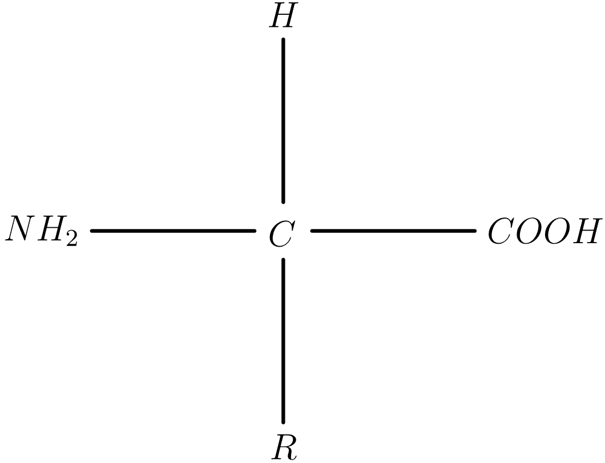
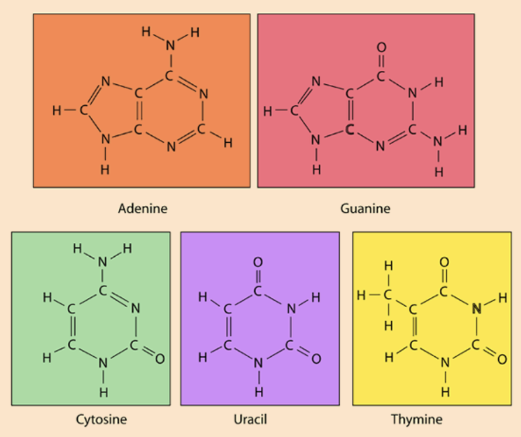

# Introduction

All the information that encodes your genes has to exist somewhere, right? Well, I'm pretty sure you know that place is DNA, in your cells. You probably heard of the genetic code too. In fact, if you've taken biology, you probably know this stuff in decent detail. I'm here to stretch how far we can view this as a language. 

# The Chemistry of Proteins, RNA, and DNA

You know how the raw form of natural language is phones and sound waves - the stuff you'd see from either the Praat software or a very detailed anatomical procedure on how to pronounce a voiceless uvular-bilabial doubly articulated stop? Similarly, the raw form of genetic information is biochemistry. 

Biochemistry is centered around macromolecules. There are four main types, but the two we will care about are proteins and nucleic acids. Proteins are quite important for a *lot* of things - for example, speeding up reactions, transport, signaling, and structure, just to name a few. We can think of their functions like semantic reference - what we intend and think about when we say something. 

## Proteins

Proteins are quite complicated. At the very surface level, it's a sequence of amino acids. 

{.lightbox}

Note that the $R$ isn't a constant molecule. Rather, it's a variable that represents the group that distinguishes all $20$ amino acids. 

However, proteins can fold to form structures, such as alpha helices or beta sheets, and the chemical properties of the environment determine how the $R$-groups interact with each other, which determines the 3D shape, which determines the function. The relationship between shape and function might sound suspicious, but it actually makes sense - enzymes (a type of protein), for example, bind to a specific molecule called the substrate, allowing reactions to speed up. Binding is similar to putting together Lego pieces, so the shape of the enzyme must be very exact - otherwise, its shape will match with the wrong type of molecule (or no molecule at all), failing its function.  

## DNA and RNA

DNA and RNA are nucleic acids. Their main function is storing and transmitting information, which is why they are like a language. The NA stands for "nucleic acid". So what does the first letter stand for? The D stands for deoxyribose, while the R stands for ribose. These are both sugars, except deoxyribose has one less oxygen atom than ribose. This isn't the only difference. RNA has a single strand of nucleotides (bases with nitrogen in them), while DNA has two strands, making the double helix shape we all know and love. 

# The part resembling language

## Nucleotides

The bases are adenine, cytosine, guanine, and thymine in DNA. In RNA, it's similar, except with uracil instead of thymine. 

Here's what these bases look like:

{.lightbox}

Also, here is the [source](http://hyperphysics.phy-astr.gsu.edu/hbase/Organic/base.html) of this image. 

These can be represented by the first letters of their names: A, C, G, T, and U.

These nitrogenous bases are called nucleotides. Long sequences of nucleotides create nucleic acids.

We can write a DNA sequence as a string of letters, like this:

5' A T G C G T A A C G 3'
3' T A C G C A T T G C 5'

The 3' and 5' are the direction of the strands, specifically which carbon is on either end (the 3' is attached to a hydroxyl group, while the 5' is attached to a phosphate group). Just know that if one strand is 5' to 3', the other strand is 3' to 5'.

You probably know that A always pairs with T, and C with G. But wouldn't this be redundant, since the other strand gives the same information? Well, this redundancy serves as an error-correcting mechanism - if one nucleotide goes missing, its corresponding base on the other strand can tell which nucleotide it was. 

## Codons and the genetic code

A *codon* is a group of three consecutive nucleotides. The genetic code takes every three codons and maps it to an amino acid. Note that this is for codons of RNA, not DNA. While DNA is meant for long term storage, RNA is what is used to make proteins. By the way, it's called transcription when DNA is written into RNA (fairly easily, since it's just base-pairing rules), and translation when RNA is used to make proteins. I'll get into the linguistics analogy in a bit. 

In translation, ribosomes (organelles to synthesize proteins) read each RNA codon from 5' to 3' and add a corresponding amino acid to the protein chain in progress. 

Now, here's the part we've been waiting for - how codons really map to amino acids. 

](genetic_code.png){.lightbox}

You should note a few things. First, we read the nucleotide from the inside to the outside, since the inside is 5' and the outside is 3'. Also, note how there are start and stop codons. It's basically metadata! The ribosome will stop reading the RNA once it encounters either UAA, UAG, or UGA. The start codon AUG actually corresponds to the amino acid methionine, rather than nothing at all, since this starts off the amino acid chain. 

Think of nucleotides as phonetic features of a phone. Vowels and consonants can usually be written in three distinctive features - (height, backness, roundedness) or (place, manner, voice), respectively. Put them together and you get an entire phone. Similarly, codons are like phones, which must have three arguments defining them. 

Amino acids are like phonemes... *kind of*. They aren't more abstract or anything, since they are just as physical. But a phoneme can be realized with multiple different phones, similar to how an amino acid can be encoded by multiple different codons. The analogy breaks down a tiny bit when you realize that the phonetic realizations of phonemes can be ambiguous. One phone might be the realization of two different phonemes (think about how in some accents of English, /n/ can sound like [m] before a /p/ or a /b/, but so would /m/, since that's its default). However, evolution ensured the genetic code was unambiguous, since the organisms who had an ambiguous genetic code would die of getting the wrong proteins all the time! English wasn't this drastic since mixing up phrases like "warm blanket" and "worn blanket" are pretty rare and not nearly as dangerous. 

Back to the genetic code... wait! It doesn't seem very efficient! There are only $20$ amino acids, but there are $61$ codons ($4^3=64$, but then subtract $3$ for the number of stop codons) that can correspond to amino acids! Well, remember how I said that the redundancy of two strands allows for error correction? Similarly, this does the same thing. If a nucleotide is wrong, there's still a decent chance that the correct amino acid will be produced.

How can a nucleotide go wrong, though? Glad you asked! That's where mutations come in.

# Mutations

A mutation is when the sequence of nucleotides changes unexpectedly. The simplest is a point mutation, where a single nucleotide changes. 

Remember how the genetic code has a bit of redundancy? GUA and GUG map to the same amino acid, valine. That means if the third nucleotide in GUA becomes a G, we're still good! This is a silent mutation, because it doesn't annoy us with metaphorical loudness. 

If instead the second nucleotide became a C, we have GCA, or alanine. Because the amino acid changes, this is a missense mutation. 

Now if we have UAU that gets mutated to UAG, our tyrosine becomes a stop codon, meaning the ribosome stops reading the RNA and stops adding to the protein. Uh-oh! There is no way this biological skill issue really works - sounds like nonsense! No, really - it's called a nonsense mutation. 

Things get a lot more annoying if we insert or delete stuff instead. After all, if sequences of nucleotides are strings, and we want to find the edit distance, we consider insertions and deletions as valid operations too, not just replacements. Since ribosomes read nucleotides in groups of three, this is a bit catastrophic, isn't it? 

Think about this sequence:

$5' \ \ \ U \ U \ C \ G \ A \ G \ A \ A \ C \ \ \ 3'$

$5' \ \ \ [U \ U \ C] \ \ [G \ C \ G] \ \ [A \ A \ C] \ \ \ 3'$

$\text{Phe} \ \ \text{Ala} \ \ \text{Asn}$

Now, suppose we add an extra uracil at position 4. 

$5' \ \ \ U \ U \ C \ U \ G \ A \ G \ A \ A \ C \ \ \ 3'$

$5' \ \ \ [U \ U \ C] \ \ [U \ G \ C] \ \ [G \ A \ A] \ \ C \ \ \ 3'$

$\text{Phe} \ \ \text{Cyc} \ \ \text{Glu} \ \ \text{???}$. 

Ouch! Now, unless there's a lucky coincidence where the rest was just a string of "AAAAAAAAAAAA" (nah, that's an extreme example; it's a lot easier to be lucky for a single amino acid), the ribosome will make the wrong amino acid most of the time from now on, and the rest of the protein is cooked. 

There are other types of mutations that are a bit bigger and don't just involve a single nucleotide. This includes repeating a section of the sequence, swapping a section, or reversing a section (duplication, translocation, or inversion, respectively). You can also have insertion and deletion of entire sections, rather than individual nucleotides. 

But hold on! Did you notice that a lot of these mutations seem similar to sound changes? If you've read [Historical Linguistics](https://vaishnavs.net/posts/Historical-Linguistics-2/), you might recall insertion or deletion as well, which work exactly the same. Metathesis is like swapping sections (except more for single phonemes rather than entire sequences), and reduplication (not really a common sound change, since it occurs more in morphological processes than phonological ones, but just to extend the analogy) is like repetition. 

While this analogy might excite you, there is a major flaw. Mutations are random and usually happen once on specific words, while sound changes systematically apply to all words at once. However, apart from that, the changes themselves are very analogous. 

# Evolution (and other related analogies)

## Natural Selection

Evolution is in part based on mutations. Mutations allow genetic diversity in a population, and organisms with better genetics will likely survive and reproduce, shifting the population's frequencies of certain alleles (forms of a gene). 

Consider the minions (100 of them) in Gru's basement. Let's say there's a gene where the allele most minions have is to spot and grab bananas very slowly. However, a mutation gives one minion, Otto, a different form of this gene, making it a lot efficient in finding bananas. If Gru dumps a few bananas in his basement every now and then, Otto will be able to steal all the bananas, while the others will die of starvation. At first, only $1 \%$ of the minions in Gru's basement have banana-eating efficiency. However, after, let's say, $95$ of the minions die, Otto's allele will be $20 \%$ of the population - a lot more. If Otto has children, and the allele is dominant (meaning any child of Otto will express this allele, regardless of the other parent), then more than $20 \%$ of the population will have this allele. Crazy how that happened, when we think about how a random mutation happened, affecting only $1 \%$ of the minions! Keep in mind that this situation is unrealistic and oversimplified, but it's just to illustrate natural selection exaggeratedly. 

The thing is, the drivers of language evolution work a bit like this too! At least, we can model it that way. Not just sound changes, but any linguistic change. For example (mainly just phonological evolution), in the phrase "going to", the velar nasal /ŋ/ got phonologically assimiliated to become the alveolar nasal /n/, since the /t/ is also alveolar. It's more like "goin-to" at this point. The /u/ in "to" became more centralized, like /ə/. Then, the /t/ itself got reduced, so it sounds like (and I'll show the full thing in the IPA this time) /goʊwɪnə/. The vowels did some funny stuff to almost neutralize, to get our final word "gonna", pronounced /gənə/. Notice that each time, the pronunciation got a bit more efficient each time, so our mouths had to do a bit less work. With linguistic variation where one person pronounced "going to" with a bit more ease than another person, more people would gravitate towards the first person's way of saying it. Again, the analogy breaks down a bit when we realize that the second person could have also adapted the easier way, which is not entirely how genes work. 

## Family Trees 

I think a better tie between the evolution of languages and life would be when we examine prokaryotes. Since bacteria and archaebacteria reproduce with binary fission, their "children" would be genetically identical to them, *except* for mutations. While some eukaryotes can reproduce with mitosis (a bit more complicated than binary fission but similar goal), another issue is that individuals can't exchange genetic information with one another. Bacteria have plasmids, or bits of DNA outside of them, that can be transferred between each other using something called a pilus. 

Do you see the similarities with languages? When one generation give their language to the next generation, it's theoretically identical, except for some changes analogous to mutations - but there's no systematic process to recombine parts of languages. I guess maybe creoles, but it could be thought of as analogous to a pilus instead. That's my next point. People's languages influence each other all the time - not just someone's English with the friends' English, but even loanwords between languages that most people would agree are distinct. Creoles, in a way, are just a very extreme case of loanwords, since the substrate kind of borrows most of its lexicon from the other language. 

As for families, biologists believe all life on Earth has a common ancestor. This would make the first cell on Earth analogous to the proto-language of a single family. Other language families would be more like alien life forms that evolved independently. 

You can even use the comparative method to reconstruct common ancestor DNA. For example, if you take a sequence of human nucleotides and a sequence of chimpanzee nucleotides, you can align the DNA (remember that insertions and deletions will cause gaps when you align them), and knowing what mutations likely happened can allow you to reconstruct the proteins of the most recent common ancestor. 

# Conclusion

Hopefully, you now understand the "linguistics" behind your genes, in a way. In the comments, feel free to share any other analogies you've noticed between the two fields! 

# Further Information

* MIT's course [24.901 "Introduction to Phonology"](https://ocw.mit.edu/courses/24-901-introduction-to-phonology-spring-2026/) had the example of "warm blanket" versus "worn blanket" potentially being ambiguous. 

* The evolution of "going to" as it became "gonna" is shown in David J. Peterson's [The Art of Language Invention](https://www.goodreads.com/en/book/show/24611649-the-art-of-language-invention).

* [This tool](https://en.vectorbuilder.com/tool/sequence-alignment.html) allows you to align two sequences of DNA, which is important for...

* Doing the [comparative method](https://www.genome.gov/about-genomics/fact-sheets/Comparative-Genomics-Fact-Sheet) on DNA!

* Here is [some deeper information](https://www.quantamagazine.org/all-life-on-earth-today-descended-from-a-single-cell-meet-luca-20241120/) about how all life evolved from a single cell.

* Meanwhile, here's some of the [analogous topic](https://slate.com/human-interest/2014/08/origin-of-languages-tower-of-babel-proto-languages-and-the-brothers-grimm.html) in linguistics, which is a lot more debated. 

* [This article](https://www.polilingua.com/blog/post/creole-languages-origins-features.htm) explains creoles in more depth. 

* Here is some [history](https://pmc.ncbi.nlm.nih.gov/articles/PMC5041012/) behind the discovery of the genetic code.

* If you're more curious about how proteins fold after their initial structure (a sequence of amino acids), you might find [AlphaFold](https://www.nature.com/articles/s41586-021-03819-2) interesting, as it's an AI that can predict how a protein's shape will change over time. 

* This goes into a bit more [detail](https://www.genomicseducation.hee.nhs.uk/blog/reading-dna-where-to-start/) about how the $3'$ and $5'$ orientations of DNA work. 